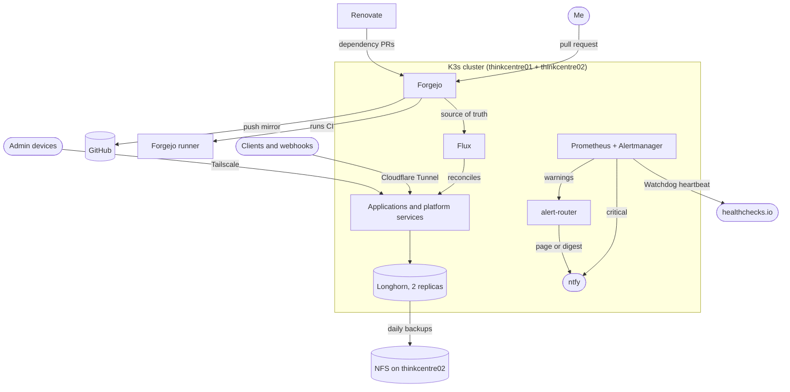

# Rubiconetic Homelab


The Git source of truth for a two-node, bare-metal Kubernetes cluster. It runs the tools my automation business depends on: workflow automation, source control, CI, password management, mail, and project management. Real work runs here, so failures have consequences, and the [post-mortems](docs/postmortems/) record the ones that taught me the most.

**Canonical repo:** [git.rubiconetic.com/michael/homelab](https://git.rubiconetic.com/michael/homelab). The GitHub copy is a push mirror.

## At a glance

| | |
| :--- | :--- |
| **Hardware** | 2 Lenovo ThinkCentre mini PCs, 4 CPU / 8 GB each |
| **Platform** | K3s v1.33 on Ubuntu 24.04, 1 server and 1 agent |
| **Workloads** | About 115 pods, including 5 Postgres instances |
| **Storage** | 19 Longhorn volumes, 2 replicas each |
| **Delivery** | Flux reconciles this repo; 90+ pull requests merged, most opened by Renovate |
| **Alerting** | Prometheus and Alertmanager to ntfy, with a dead-man's switch on healthchecks.io |

## Architecture



## How a change reaches the cluster

1. A change lands in a pull request. Renovate opens most of them.
2. CI runs `kustomize build`, validates the output with `kubeconform` against the cluster's Kubernetes version, and rejects plaintext credentials in connection strings.
3. On merge, Flux applies the change, usually within a minute. `prune: true` means anything removed from Git is removed from the cluster.
4. Flux alerts report failed reconciliations. A single bad manifest blocks everything in a Kustomization, so this needs its own signal.

`torrenter` goes one step further: its GitHub Actions build publishes an image, Flux image automation commits the new tag here, and the rollout follows the same path.

## Design decisions

| Decision | Why | Trade-off |
| :--- | :--- | :--- |
| **K3s** | Small footprint on 8 GB nodes | Single server on SQLite, so the control plane has no failover |
| **Flux** over Argo CD | Pull-based, with no UI to run or expose on small nodes | Less visual feedback, so Flux alerting has to be deliberate |
| **Self-hosted Forgejo** as Flux's source | I own the whole delivery path | Forgejo is a dependency of its own deployments, so upgrades need a careful order ([runbook](docs/runbooks/forgejo-postgres-upgrade.md)) |
| **SOPS + age** | Secrets stay encrypted in a public repo with no extra service | A whole-file re-encrypt can silently revert values ([post-mortem](docs/postmortems/2026-09-secrets-wipe-and-stale-reencrypt.md)) |
| **Cloudflare Tunnel + Tailscale** | Webhooks stay reachable with no open firewall ports; admin tools stay private | Depends on two outside services |
| **Longhorn, 2 replicas** | Volumes survive losing one node | Two nodes can't tolerate much else, and replicas share a disk with backups |
| **CPU requests, no CPU limits; memory limits always** | CPU limits throttled Prometheus during recovery while the node sat idle. Memory is the one that takes a node down | One noisy pod can use spare CPU |

The cluster-wide resource policy, with the measurements behind it, is at the top of [`manifests/kustomization.yaml`](manifests/kustomization.yaml).

## Reliability work worth reading

- **[alert-router](https://git.rubiconetic.com/michael/alert-router):** a small Python service, in its own repo, that decides whether a warning pages me, goes in a digest, or is suppressed. I benchmarked model calibration first, because a local model reported 0.95 confidence on every input, including the ones it got wrong. It fails open on every error path, critical alerts and the dead-man's switch bypass it entirely, and it ships as a signed image. Moving it out of a ConfigMap and writing real tests found five ways it could still lose an alert. ([Deployment](manifests/infrastructure/alert-router.yaml))
- **[Reliability alerts](manifests/infrastructure/reliability-alerts.yaml):** each rule exists because of a failure that went unnoticed, and the comments record the numbers.
- **[Network policies](manifests/infrastructure/network-policies.yaml):** ingress is default-deny, and each database accepts connections only from its own app and the nightly dump. The rules came from measurements, not documentation: a LoadBalancer connection reaches the pod with the real client IP or a flannel address depending on which node took it, so the obvious "allow kube-system" rule matches nothing. [`scripts/netpol-check.sh`](scripts/netpol-check.sh) checks 46 allowed and blocked paths.
- **[Flux alerts](manifests/infrastructure/flux-alerts.yaml):** added after a failed build silently froze every deployment for about 35 minutes.

## Post-mortems

- [Five days of silent alerts](docs/postmortems/2026-09-silent-alerts.md): a node ran out of memory, Prometheus filled its disk, and alerts had been going nowhere.
- [Secrets wiped, then silently reverted](docs/postmortems/2026-09-secrets-wipe-and-stale-reencrypt.md): an empty file made Flux delete 21 Secrets, and the recovery habit caused an outage five weeks later.
- [Forgejo repositories lost their git data](docs/postmortems/2026-06-forgejo-repository-loss.md): 37 repositories lost their objects, and backups had already aged out.
- [Postiz down for 15 hours on an image pull](docs/postmortems/2026-10-postiz-image-pull.md): a bad pull credential met a routine update, and alerts fired that never reached the phone.
- [First EKS restore drill](docs/postmortems/2026-10-eks-restore-drill.md): Forgejo and Kaneo restored from S3 alone, and the drill's own script hung for 2.5 hours.

## Backups

| Layer | Schedule | Retention | Destination |
| :--- | :--- | :--- | :--- |
| Longhorn volume backups | Daily, 03:00 | 7 days | NFS on thinkcentre02 |
| `pg_dumpall` for each application database | Daily, 04:00 to 04:30 | 7 days | NFS on thinkcentre02 |
| Encrypted restic copy of both layers and etcd snapshots | Daily, 05:00 | 7 daily, 4 weekly, 6 monthly | AWS S3 |

The S3 bucket, IAM user, and budget alert are [Terraform](terraform/offsite-backups/main.tf). The bucket is versioned, and the restic key can't remove versions or change bucket settings, so a stolen key can hide data for up to 30 days but can't destroy it. A weekly job downloads and verifies 5% of the data.

Dump jobs and the off-site job alert if they miss a run. On 2026-10-30, the first off-site backup was restored from S3 and the Postgres dumps matched the originals exactly.

On 2026-10-31, a [timed drill](docs/runbooks/eks-restore-drill.md) restored Forgejo and Kaneo into a temporary EKS cluster from S3 alone. Forgejo was ready in 1 hour 19 minutes, about 19 of them lost to an error in the drill. All 77 repositories came back with no `git fsck` failures, and Kaneo's row counts matched exactly. The [write-up](docs/postmortems/2026-10-eks-restore-drill.md) covers everything that went wrong.

## Known limitations

- **Restores can lose up to a day.** Volume backups run daily, and the drill restored only Forgejo and Kaneo, not the whole stack.
- **Single control plane.** Losing thinkcentre01 stops scheduling and API access until it returns.
- **Two nodes can't absorb much.** Total requests exceed one node's capacity, so a long node outage means degraded service.
- **Egress is open.** [Network policies](manifests/infrastructure/network-policies.yaml) restrict which pods can connect to which, but any pod can still connect out. Most workloads share the `default` namespace.
- **Nodes aren't provisioned from code.** The cluster's contents are declarative, but the OS and K3s install are not.

## Repository layout

```txt
clusters/my-cluster/   Flux bootstrap, sync config, image automation
manifests/
  automation/          n8n and its Postgres
  communication/       Stalwart mail
  infrastructure/      Monitoring, alerting, Longhorn, backups, Vaultwarden, Renovate
  media/               Torrenter, Jackett
  productivity/        Forgejo and runner, Kaneo, Obsidian sync
  secrets/             SOPS-encrypted Secrets
  social/              Postiz and its dependencies
docs/
  postmortems/         What failed, why, and what changed
  runbooks/            Step-by-step operational procedures
  archive/             Finished plans and research
scripts/               Git hooks, the restore-drill script, and the network-policy check
terraform/             AWS state bucket and off-site backup infrastructure
```

## Roadmap

- [x] Off-site backups, with Terraform-managed storage
- [x] Timed restore drill into a temporary cloud cluster
- [x] [Alert-router](https://git.rubiconetic.com/michael/alert-router) as its own repo with tests, signed images, and metrics
- [x] [Default-deny ingress](manifests/infrastructure/network-policies.yaml), with each database reachable only from its own app and backups
- [ ] Egress policies and per-application namespaces

---

Built and operated by [Michael Rubi](https://michaelrubi.com). Licensed under [MIT](LICENSE).
